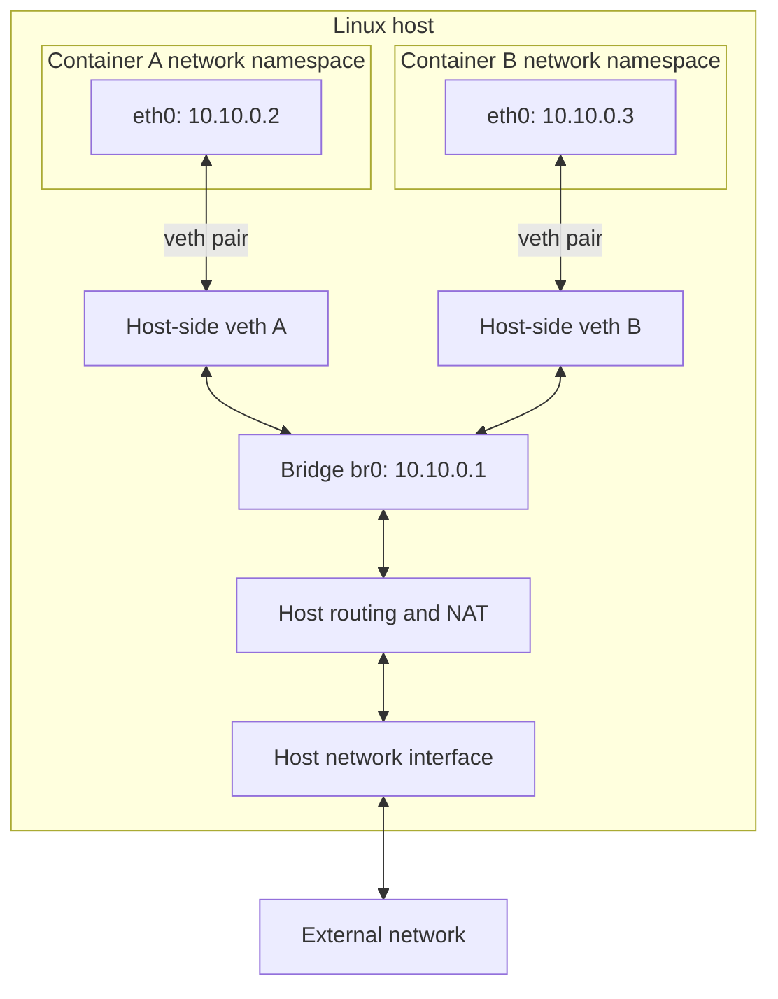

The image shows **how Linux gives a container its own network and connects it to other containers and the outside world**.

The left column describes the setup steps. For ordinary bridge networking, Docker manages this setup automatically, as represented by the right column. A bridge is shared by the containers attached to that network. [Docker Docs](https://docs.docker.com/engine/network/drivers/bridge/?utm_source=chatgpt.com)

Imagine two containers running on one Linux host. This is the network we want to build:



Let’s follow the eight steps in your image.

1. **Create a network namespace — give the container its own network view.**

   A Linux network namespace provides separate network interfaces, routing tables, firewall rules, and port numbers.

   Container A sees its own interfaces and routes. Container B sees its own interfaces and routes. Each has its own `localhost`.

   This is why separate containers can both listen on port `8080` without conflicting: they have separate network namespaces.

   A network namespace is a Linux kernel feature; it does not require a separate operating system or kernel. [Linux manual page](https://man7.org/linux/man-pages/man7/network_namespaces.7.html?utm_source=chatgpt.com)

   Also, **a Linux network namespace and a Kubernetes namespace are different concepts**. Kubernetes namespaces such as `default` and `kube-system` organise Kubernetes resources.

2. **Create a bridge — provide a virtual network switch.**

   A bridge connects several network interfaces, much like a physical switch connects several computers.

   In our example, `br0` lives in the host’s network namespace. Both containers will connect to it.

   You normally create one bridge for a network and reuse it for its attached containers.

   The bridge forwards local traffic between the connected interfaces. It is not automatically an internet router. [cni.dev](https://www.cni.dev/plugins/current/main/bridge/?utm_source=chatgpt.com)

3. **Create veth pairs — provide virtual network cables.**

   **veth means virtual Ethernet.**

   A veth pair consists of two connected virtual interfaces. A packet transmitted through one end arrives at the other end.

   For Container A, create two ends:

   | End | Where it will live |
   |---|---|
   | Container-side interface | Inside Container A’s namespace |
   | Host-side interface | Inside the host’s namespace |

   Create a separate pair for Container B.

   Think of each pair as one cable with two ends. [Linux manual page](https://man7.org/linux/man-pages/man4/veth.4.html?utm_source=chatgpt.com)

4. **Attach one veth end to the namespace — give the container a network interface.**

   Move the container-side interface into Container A’s network namespace.

   It is commonly renamed `eth0` there.

   Container A can now send packets through this interface. Those packets emerge from the paired host-side interface.

   Container B gets its own interface in its own namespace. Both can call their interface `eth0`, because the names belong to separate namespaces. [Linux manual page](https://man7.org/linux/man-pages/man4/veth.4.html?utm_source=chatgpt.com)

5. **Attach the other veth end to the bridge — connect the cable to the switch.**

   The host-side end stays in the host’s namespace and becomes a port on `br0`.

   Repeat this for Container B.

   Now traffic from A to B can travel through:

   ```text
   A’s eth0 → host-side veth A → bridge → host-side veth B → B’s eth0
   ```

   Both containers are connected to the same virtual switch. [cni.dev](https://www.cni.dev/plugins/current/main/bridge/?utm_source=chatgpt.com)

6. **Assign IP addresses — give the interfaces addresses applications can use.**

   For example:

   | Interface | Address |
   |---|---|
   | Container A’s `eth0` | `10.10.0.2/24` |
   | Container B’s `eth0` | `10.10.0.3/24` |
   | Host bridge `br0` | `10.10.0.1/24` |

   These addresses belong to the same subnet, so A and B can communicate locally through the bridge.

   The bridge’s address can serve as the containers’ gateway for reaching other networks.

   **The host-side veth interfaces usually do not need their own IP addresses.** They act as bridge ports. A bridge can also switch traffic without having an IP; its IP is useful here because the host provides gateway access. [cni.dev](https://www.cni.dev/plugins/current/main/bridge/?utm_source=chatgpt.com)

7. **Bring the interfaces up — enable them to carry traffic.**

   Creating an interface and assigning an IP do not necessarily enable the interface.

   Linux interfaces have an administrative state such as `UP` or `DOWN`.

   Bring up the bridge, the veth interfaces, and the namespace’s loopback interface.

   This is similar to enabling a network adapter. An interface that remains down cannot provide the expected connectivity. [Linux manual page](https://man7.org/linux/man-pages/man8/ip-link.8.html?utm_source=chatgpt.com)

8. **Enable NAT/IP masquerading — let containers use the host’s outgoing address.**

   Suppose Container A contacts an external server. Its packet starts with source address `10.10.0.2`.

   The external network may have no route back to that private container address.

   **Masquerading rewrites the outgoing packet’s source address to the host’s outgoing interface address.**

   Linux tracks the connection. When the reply arrives, it maps that reply back to Container A.

   This is a form of **source NAT**, commonly used for external access from Docker bridge networks. Further address translation may happen at an upstream router. [Docker Docs](https://docs.docker.com/engine/network/drivers/bridge/?utm_source=chatgpt.com)

There are a few additional requirements behind that final step: the container needs a route through its gateway, the host must have a working onward route, **IP forwarding must be enabled**, and firewall rules must permit the forwarding. Masquerading alone does not provide the complete path. [The Linux Kernel documentation](https://docs.kernel.org/networking/ip-sysctl.html?utm_source=chatgpt.com)

For Kubernetes, these ideas explain the foundation of Pod networking. **Ordinary containers within one Pod share a network namespace**, which is why they share a Pod IP and communicate using `localhost`. The runtime and networking implementation arrange the Pod’s connectivity. A bridge is one possible implementation; other networking solutions use different arrangements, particularly for communication across nodes. [kubernetes.io](https://kubernetes.io/docs/concepts/workloads/pods/?utm_source=chatgpt.com)
